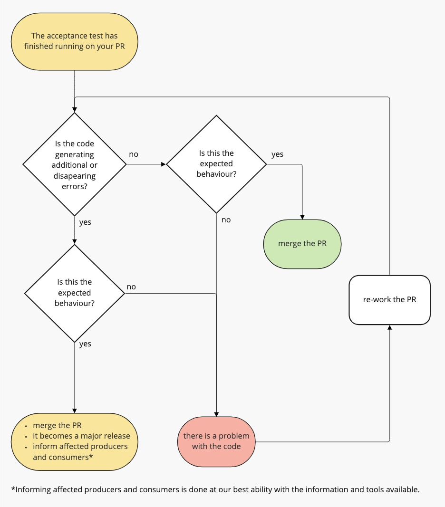

# Rule acceptance tests 

## Goal

Because GTFS data consumers and producers rely on the validator it is important to know if a pull request introduces a breaking change (i.e. the proposed validator declares existing valid datasets invalid).
If this step is skipped, newly declared invalid datasets could be rejected by GTFS data consumers (e.g. Transit App, Google Maps) which could lead to public transit systems disappearing from their interface which means that riders would no longer be able to access the trip information they are used to getting on these platforms.   

## Definitions
- **The reference validator** is defined as the latest version of the validator available on the ([master branch](https://github.com/MobilityData/gtfs-validator/tree/master)) of this repository, or the commit chosen with `baseline_ref` in a manual run.
- **The proposed validator** is defined as the version of the validator that results from the changes introduced in the pull request that is proposed.
- **The acceptance criteria** (mentioned in the diagram below) is defined as the impact that a pull request has on datasets: does this pull request disrupt a large quantities of datasets? If yes, the pull request should be flagged as introducing breaking changes or rejected, if no then the pull request can be safely merged to the [`master` branch](https://github.com/MobilityData/gtfs-validator/tree/master).
   
## Process description

For the latest version of all GTFS datasets from the [MobilityDatabase](http://old.mobilitydatabase.org/wiki/Main_Page), the validation report from both the proposed and the reference validator are compared. An acceptance test report is generated: it quantifies for each agency/dataset the number of new notice (as defined [here](https://github.com/MobilityData/gtfs-validator/blob/master/RULES.md#definitions)) that have been introduced.


## Github Actions

The logic for this process is defined in [`acceptance_test.yml`](../.github/workflows/acceptance_test.yml).

This workflow:
1. packages the `output-comparator` module;
1. packages the proposed version of the validator;
1. downloads the version of the reference validator that is on the [`master` branch](https://github.com/MobilityData/gtfs-validator/tree/master);
1. defines a matrix of urls (fetched from the [MobilityDatabase](http://old.mobilitydatabase.org/wiki/Main_Page)) that will be used in the further validation process; 

On each of these urls:
1. the reference version of the validator is executed and the validation report is output as JSON (under `reference.json`);
1. the proposed version of the validator is executed and the validation report is output as JSON (under `latest.json`).

The reference reports only depend on master's code and on the feed's file, so they are cached by feed ID and file hash, per master commit. When a feed's file is unchanged, the reference report of an earlier run is reused and only the proposed validator runs. A fixed sample of about 25% of the feeds, picked by feed ID, never reuses it, so that both validators run in the same job and their timings can be compared. Feeds of 500 MB or more are left out of that sample: each one is alone in its job, and running the reference validator again would make the whole workflow wait longer.

Next to each feed's reports, `feed.json` records how the feed was validated: the size of its zip file (`zipBytes`, `null` when the download failed), whether the reference report was reused (`masterReused`), the runner and its number of processors. The validators do not read or write this file.

At the end of execution of the two aforementioned steps for every url in the matrix, all the validation
reports are gathered in a single folder (`output`) and compared - the percentage of newly invalid datasets
is output to the console.  The final acceptance test report is output at `acceptance_report.json`.
It includes a summary of both new notice types and dropped notice types.  It also contains a list of
"corrupted" sources: sources that could not be taken into account while generating the acceptance test 
report because of I/O errors, or missing file.  

To finish with, a comment that sums up the acceptance test result is issued on the PR.

Example output:
- `acceptance_report.json`
```json
{
  "newErrors": [
    {
      "noticeCode": "first_notice_code",
      "affectedSourcesCount": 2,
      "affectedSources": [
        {
          "sourceId": "source-id-1",
          "sourceUrl": "url to the latest version of the dataset issued by source-id-1",
          "noticeCount": 4
        },
        {
          "sourceId": "source-id-2",
          "sourceUrl": "url to the latest version of the dataset issued by source-id-2",
          "noticeCount": 6
        }
      ]
    },
    {
      "noticeCode": "second_notice_code",
      "affectedSourcesCount": 1,
      "affectedSources": [
        {
          "sourceId": "source-id-5",
          "sourceUrl": "url to the latest version of the dataset issued by source-id-5",
          "noticeCount": 5
        }
      ]
    },
  ],
  "droppedErrors": [
    # Same schema as `newErrors`
  "newWarnings": [
    # Same schema as `newErrors`
  "droppedWarnings": [
    # Same schema as `newErrors`
  "newInfo": [
    # Same schema as `newErrors`
  "droppedInfo": [
    # Same schema as `newErrors`
  ],
  "corruptedSources": {
    "corruptedSources": [
      "source-id-1",
      "source-id-2"
    ],
    "sourceIdCount": 1245,
    "aboveThreshold": false,
    "corruptedSourcesCount": 2,
    "maxPercentageCorruptedSources": 2
  }
}
```

Where each source id value come from the MobilityDatabase: they are a unique [property](http://old.mobilitydatabase.org/wiki/Property:P33) used to identify each source of data.

The source id can be used to find all datasets versions of a source on the [MobilityDatabase](http://old.mobilitydatabase.org/wiki/Main_Page) for the sakes of debugging or exploration.

## What do we do with the results?
We follow this process:



## Performance metrics within the acceptance reports

The _Performance Assessment_ section of the PR comment compares the reference and proposed validators on every dataset. It is **not a blocker**, since timings vary with the GitHub runners, but large or unexpected changes should be investigated before approving a PR.

### Measurements

Each validation records its measurements in `report.json`, under `summary.performanceMetrics`. A validation has four phases: `input` (reading or downloading the feed), `loadTables`, `multiFileValidators` and `feedMetadata`. Report generation is not measured.

| Metric | What it measures | Flag threshold |
|---|---|---|
| Wall time | Elapsed time of all phases except `input`, so that download time does not count. | 5% |
| CPU time | CPU time of the validation thread and of the tasks it runs in the loader's thread pool. Excludes the garbage collector and JIT threads. | 5% |
| Allocated memory | Bytes allocated by those same threads. Nearly identical between runs of the same code, so small changes are real. | 1% |
| Peak heap after GC | Highest heap in use right after a garbage collection run by the JVM on its own. Empty when none ran, which is common on small feeds since CI starts with an 8 GB heap. | 5% |
| Peak live heap | Highest heap in use after a full garbage collection forced at the end of each phase. Measured on every feed. Enabled in CI with `-Dgtfsvalidator.performance.liveHeap=true`. | 2% |

When either validator does not report these metrics, only the validation time is compared.

The _Out of Memory Check_ lists the datasets whose validation ran out of memory (12 GB heap in CI). They are left out of every other check and statistic.

### How the comparison works

- Each metric is compared per dataset as latest / reference, so that every dataset weighs the same.
- Datasets are grouped by the size of their zip file: < 10 MB, 10 to 50 MB, 50 to 100 MB, 100 to 200 MB, 200 to 500 MB and >= 500 MB. Datasets whose download failed are grouped as _unknown size_. The size does not depend on either run, and the bounds above 50 MB fall in gaps between the sizes of the feeds, so that a feed rarely moves to another group.
- Wall time, CPU time and peak heap after GC depend on the machine, so they are only compared on the datasets whose two reports were produced in the same job. Allocated memory and peak live heap are compared on every dataset. The comment says how many datasets the timings used.
- Each metric has its own collapsible section, with a short description and a table by size group. For each group, the table shows the median and the geometric mean of the changes, with a 95% bootstrap confidence interval.
- A change is flagged as _Regression_ or _Improvement_ only when the whole interval is beyond the metric's threshold and the group has at least 5 datasets.
- _Largest wall time changes per feed_ lists the 10 datasets of at least 2 s with the largest wall time change, with their zip size and all their metrics.

### How to read it

- Start with the flagged lines, then open the metric's section: a group's median shows what a typical feed does, while the geometric mean can be pulled by a few feeds.
- Memory: _Peak live heap_ is what the validator keeps, which decides whether a feed fits in memory. _Allocated memory_ is what it creates, which costs garbage collection and CPU time. A change can lower one and raise the other.
- Memory against CPU. These often move in opposite directions:
  - Lower live heap, higher CPU and allocation: less data is kept and rows are rebuilt on each read, for example a table stored as compact columns.
  - Higher live heap, lower CPU: results are kept to avoid recomputing them, for example a per-trip cache.
  - _CPU time_ excludes the garbage collector, so a smaller heap's savings show in wall time, not CPU.

  A memory fix is expected to cost some CPU, and a speed fix some memory.
- Timings: a single feed's time can vary by more than 20% between runs. Trust a timing change when it shows across a group, or when CPU time or allocated memory move the same way.
- The groups above 100 MB have few datasets, and fewer still have timings on a regular PR run. To compare the timings of every feed, run the pipeline manually without reusing the reference reports (see below). The >= 500 MB group has 2 datasets and is never flagged: check them in the per-feed table.

## Instructions to run the pipeline

1. Provide code changes by creating a new PR on the [GitHub repository](https://github.com/MobilityData/gtfs-validator);
2. The acceptance test pipeline will run each time code is pushed on the newly created branch; **except if** the keyword `[acceptance test skip]` is included in the commit message.

To validate every feed with both validators in the same job, for example to check a performance change, run the pipeline manually: in the Actions tab, open _Rule acceptance tests_, click _Run workflow_, pick the PR's branch and uncheck `reuse_master_reports`. The report is written to the run summary only, not posted on any PR. A manual run validates the branch as is, not merged with master, and is only available for branches of this repository.

To compare the branch with another reference than master, for example the commit before a performance change or a release tag, fill in `baseline_ref` with a branch, tag or commit SHA when starting a manual run. The reference validator is then built from that commit, and the report says which commit it was built from. The reference reports of such a run are not saved for reuse. The baseline must be from March 2024 (#1683) or later: older validators lack the `--skip_validator_update` option, and the run stops before validating any feed.

By default, the pipeline validates a fixed list of about 1,000 feeds, committed in [`acceptance_test_feed_list.csv`](../scripts/mobility-database-harvester/acceptance_test_feed_list.csv). To validate more feeds, for example to investigate the differences between releases, set `feed_list` when starting a manual run:
- `acceptance`: the fixed list (default);
- `active`: the active GTFS feeds of the [Mobility Database catalog](https://files.mobilitydatabase.org/feeds_v2.csv) that have a latest dataset, about 2,800;
- `non-deprecated`: the same, also with the inactive, future and development feeds, about 3,600.

A run over the catalog takes longer and costs more, since more feeds need the large runner. More feeds also fail to download, so the corrupted sources check may fail on its own.

### Notice comparison CSV

Every run writes `notice_comparison.csv` to the `acceptance_test_report` artifact. It compares the notices of the reference and latest reports of every feed, with one row per feed and notice code. Unlike the acceptance report, which only lists the codes that appear in or disappear from a feed, it also shows count changes of a code present in both reports.

#### Columns

| Column | Type | Description |
|---|---|---|
| `feed_id` | string | Mobility Database ID of the feed, for example `mdb-1000`. |
| `code` | string | Notice code. For a `system_errors_*` row, the system error codes, separated by `;`. Empty for other failed feeds. |
| `severity` | string | `ERROR`, `WARNING` or `INFO`: the severity in the reference report, or in the latest report for a new code. |
| `total_previous` | integer | Number of notices with this code in the reference report, 0 if the code is absent. |
| `total_current` | integer | Number of notices with this code in the latest report, 0 if the code is absent. |
| `new_notices` | integer | `total_current - total_previous` when positive, otherwise 0. |
| `dropped_notices` | integer | `total_previous - total_current` when positive, otherwise 0. |
| `source_url` | string | URL the feed was downloaded from. |
| `status` | string | `ok` when both reports were compared, otherwise why the feed could not be compared (see below). |

The counts are empty when `status` is not `ok`.

#### Status

A feed that could not be compared has a single row. Its status is checked in the same order as the acceptance report, and is followed by the report concerned: `_reference`, `_latest` or `_reference_latest`.

| Status | Meaning |
|---|---|
| `ok` | Both reports were compared. |
| `out_of_memory_*` | The validator ran out of memory. |
| `missing_*` | The report was not written, for example when the feed could not be downloaded. |
| `unreadable_*` | The report is not valid JSON, for example when it was cut short. |
| `system_errors_*` | The report has no notices and the system errors report has some, for example when the feed could not be read. |

#### Example

```csv
"feed_id","code","severity","total_previous","total_current","new_notices","dropped_notices","source_url","status"
"mdb-1","duplicate_key","ERROR",3,3,0,0,"https://files.mobilitydatabase.org/mdb-1/latest.zip","ok"
"mdb-1","missing_recommended_field","WARNING",5,0,0,5,"https://files.mobilitydatabase.org/mdb-1/latest.zip","ok"
"mdb-2","foreign_key_violation","ERROR",0,4,4,0,"https://files.mobilitydatabase.org/mdb-2/latest.zip","ok"
"mdb-1114","i_o_error",,,,,,"https://files.mobilitydatabase.org/mdb-1114/latest.zip","system_errors_reference_latest"
```

Rows are sorted by feed ID, in numeric order (`mdb-2` before `mdb-10`), then by notice code. Codes whose count did not change are included with zeros. A feed whose reports both have no notices has no row.

#### Building it from a run

Download the `reports_all` and `datasets_metadata` artifacts of the run, then:

```sh
scripts/export_notice_diff_csv.sh <reports_all folder> <datasets_metadata folder>/gtfs_latest_versions.json notice_comparison.csv
```

A failure of the CSV export does not fail the acceptance tests. If the comparator stops on an unexpected error before writing its report, the CSV is still written, and the PR comment and run summary link to the run logs.

## Instructions to verify the execution of the pipeline

1. Download all validation reports from the artifact listed for the specific GitHub run;
2. One can verify that the count of validation report (1 per source) matches the number of sources announced by the GitHub PR comment
3. Select a sample of validation reports and compare them manually. MobilityData uses an internal tool to do so. We will open source it in the future.
